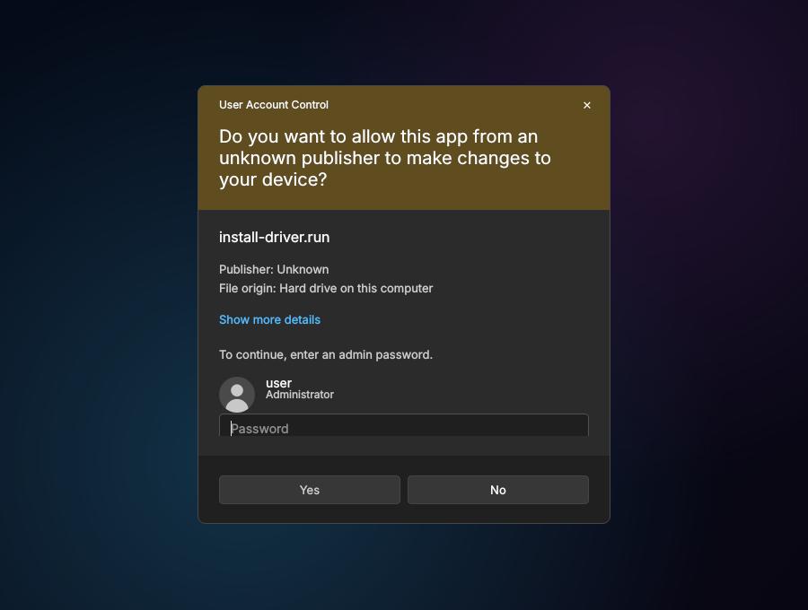
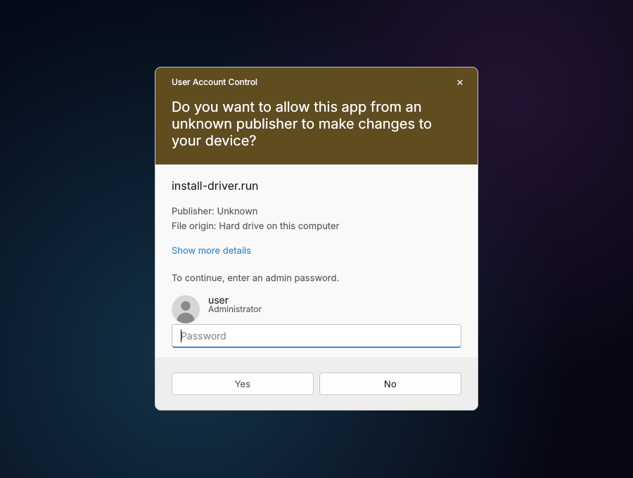
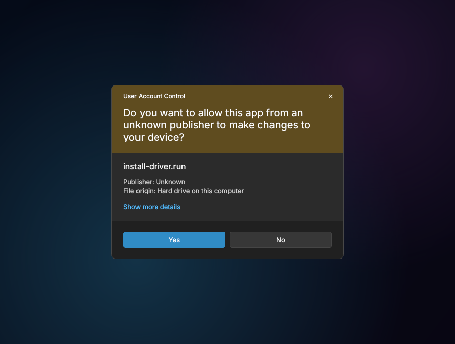

# UACWin

A Windows UAC–style admin prompt for KDE Plasma on Linux.

UACWin replaces KDE's polkit password dialog with a prompt modeled on Windows User Account Control:
the screen dims, and a card asks *"Do you want to allow this app to make changes to your device?"*
with **Yes** / **No**.

| Unknown publisher (dark) | Verified publisher (dark) | Light theme | Yes/No only (no password) |
|---|---|---|---|
|  |  |  |  |

## What it does

- **Dims every monitor** and shows the prompt in the middle of the screen.
- **Amber header** for programs that no installed package owns (downloaded binaries, scripts, AppImages).
- **Blue header with "Verified publisher"** for programs installed by your package manager
  (`dpkg`, `rpm` or `pacman`). The publisher is the package's maintainer or vendor.
- **Show more details** reveals the program location, package, command line, polkit's reason and the action ID.
- For scripts (`pkexec python3 ./setup.py`) it names the script, not `python3`.
- Asks for your **password** by default. Fingerprint login works too if you have set it up.
- Optional **Yes/No-only mode**: approve with one click and no password, like a Windows admin account (see below).
- **Plays a sound** when the prompt opens, taken from your KDE sound theme (see below).
- Follows KDE's light/dark theme and uses your KDE accent color for the Yes button and links.
- Three wrong passwords cancel the request. Esc, ✕ or **No** cancel it immediately.

## Install

### 1. Build dependencies

Kubuntu 24.04 / Debian 12 (Plasma 5):

```bash
sudo apt install build-essential cmake qtbase5-dev libpolkit-qt5-1-dev
```

Kubuntu 25.04+ / Debian 13 (Plasma 6):

```bash
sudo apt install build-essential cmake qt6-base-dev libpolkit-qt6-1-dev
```

Fedora KDE:

```bash
sudo dnf install gcc-c++ cmake qt6-qtbase-devel polkit-qt6-1-devel
```

Arch / EndeavourOS / Manjaro:

```bash
sudo pacman -S --needed base-devel cmake qt6-base polkit-qt6
```

### 2. Build, install and switch agents

Run as your normal user (not with `sudo`):

```bash
./scripts/install.sh
```

The script builds the agent, installs it to `/usr/local`, turns off KDE's polkit agent **for your user only**,
and starts UACWin as a systemd user service. If UACWin fails to start, the script puts KDE's agent back.

### 3. Try it

```bash
pkexec true
```

### Preview without installing

```bash
./build/uacwin-agent --preview             # amber "unknown publisher" prompt
./build/uacwin-agent --preview --verified  # blue "verified" prompt
```

In preview mode, typing `wrong` shows the wrong-password state. Anything else closes it.

## Yes/No only (no password)

```bash
./scripts/enable-no-password.sh
```

After this, prompts show only **Yes** and **No**. Clicking Yes approves without a password if your account is in
the `sudo` or `wheel` group. To make the password box come back:

```bash
./scripts/disable-no-password.sh
```

How it works: the script adds one rule to the top of `/etc/pam.d/polkit-1` that lets members of your admin group
pass polkit's password check. UACWin starts that check only after you click **Yes**, so nothing is approved
without a click. `sudo` in a terminal is not affected and still asks for your password.

> **Security trade-off.** With this mode on, any program running as you can get admin rights without your
> password, either by clicking the prompt or by replacing UACWin with its own agent. Windows UAC has the same
> weakness on admin accounts. Leave it off if you share your account or run untrusted software.

## Sound

When the prompt opens, UACWin plays the first sound it finds in this list:

1. `UACWIN_SOUND`, if set: a sound-theme name (`dialog-question`), a file path, or `none` to mute.
2. The sound you chose for KDE's own login prompt: **System Settings → Notifications → Applications →
   Authentication System → Authenticate → Play a sound**.
3. `dialog-warning-auth` from your current sound theme (**System Settings → Sound theme** on Plasma 6). If the
   theme doesn't have it, UACWin falls back to `dialog-warning`, then to the `freedesktop` theme.

To see which file it will play:

```bash
/usr/local/libexec/uacwin-agent --which-sound
```

It plays the file with `pw-play`, `paplay` or `canberra-gtk-play`, whichever is installed.

## Uninstall

```bash
./scripts/uninstall.sh
```

This stops UACWin, turns off Yes/No-only mode if it was on, turns KDE's agent back on, and removes the installed files.
If the prompt ever stops appearing, `sudo` in a terminal still works, so you can always run the uninstall script.

## Options

| Flag / env var | Effect |
|---|---|
| `--theme dark\|light` or `UACWIN_THEME=` | Force a theme instead of following KDE |
| `--no-dim` or `UACWIN_NO_DIM=1` | Show only the card, without dimming the screen |
| `UACWIN_SOUND=` | Sound to play: theme name, file path, or `none` |
| `UACWIN_MODE=password` | Always show the password box, even when Yes/No-only mode is on |
| `--preview --consent` | Preview the Yes/No-only prompt |

To set an env var for the service: `systemctl --user edit uacwin-agent`, then add

```ini
[Service]
Environment=UACWIN_THEME=dark
```

## Logs

```bash
journalctl --user -u uacwin-agent -f
```

## Limitations

- Windows draws UAC on a separate "secure desktop" that other apps can't see or click.
  UACWin is a normal window on your desktop. That is why the default mode asks for a password.
- "Verified publisher" only means an installed package owns the file. Unlike Windows, it does not check a code signature.
- On Wayland, KWin decides which window gets focus. If the prompt opens without keyboard focus, click it.
